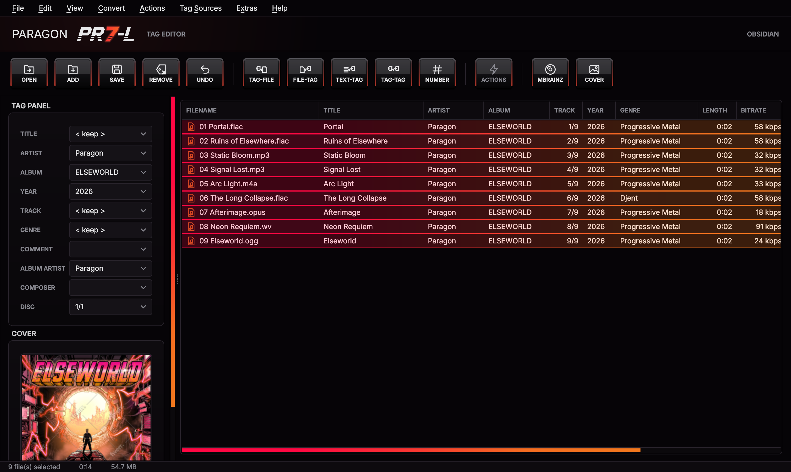

# Paragon PR7-L

The Paragon family's tag editor. It works the way **Mp3tag** works and wears the family's look (Paragon PR7-Z,
PR7-W, the PR7 plugins): tag panel and cover on the left, the file grid on the right, Mp3tag's menus and keys.

## What it does (0.2.0)

- **Every common format**: MP3, FLAC, Ogg Vorbis, Opus, M4A/MP4, WMA, WavPack, Monkey's Audio, Musepack,
  WAV, AIFF, TTA, DSF. Tags are read and written by [mutagen](https://github.com/quodlibet/mutagen); only the
  tag is rewritten, never the audio (the tests compare the audio bytes before and after every edit).
- **Tag panel**: `< keep >` where the selected files differ, `< blank >` or empty removes a field,
  several values separated by `\\`. **Ctrl+S** saves, **Ctrl+Z** undoes (the whole tag comes back),
  **Ctrl+R** removes tags, **Ctrl+C / Ctrl+V** copy and paste a tag, **Alt+T** shows every field.
- **Covers**: add, extract, replace, resize, remove, copy/paste, drop an image on the cover. Options can
  shrink added covers to a size.
- **MusicBrainz (Ctrl+I)**: search by artist and album (or paste a release link), pick the release, line
  its tracks up with your files (matching lengths light up), OK writes the tags in MusicBrainz Picard's
  field names, with the front cover from the **Cover Art Archive** (500 / 1200 / original) and optionally
  `folder.jpg`. **Tag Sources > Cover Art Archive** fetches only the cover.
- **ID3**: v2.3 (UTF-16) + ID3v1 by default, as Mp3tag; v2.4 in Options.
- **Convert**: Tag - Filename (Alt+1), Filename - Tag (Alt+2), Text file - Tag (Alt+3), Tag - Tag (Alt+5)
  with Mp3tag's format strings (`$num(%track%,2) - %title%`, `$caps(%title%)` ...), a preview before OK, and
  Undo (renames too). **Auto-numbering Wizard** (Ctrl+K).
- **Fast reopening**: a file cache, so a big library is read once; afterwards only new or changed files are
  read (F5 reads everything again). The folders that were open come back when PR7-L starts.
- **Explorer**: "PR7-L" on the right-click menu of folders and audio files.
- **Finishes**: OBSIDIAN and AURORA (Options).

Coming next: actions, export and playlists, filter, Discogs. Those menu items are there but greyed out.

## Install

Download `PR7-L-Setup-x.y.z.exe` from the latest build (Actions > build > artifacts) or a release. It
installs for your user only (no admin rights) and adds the Explorer item.

## Develop

    pip install -r requirements.txt -r requirements-dev.txt
    python -m pr7l [folder]
    python -m pytest                  # offscreen; PR7L_LIVE=1 also asks the real MusicBrainz
